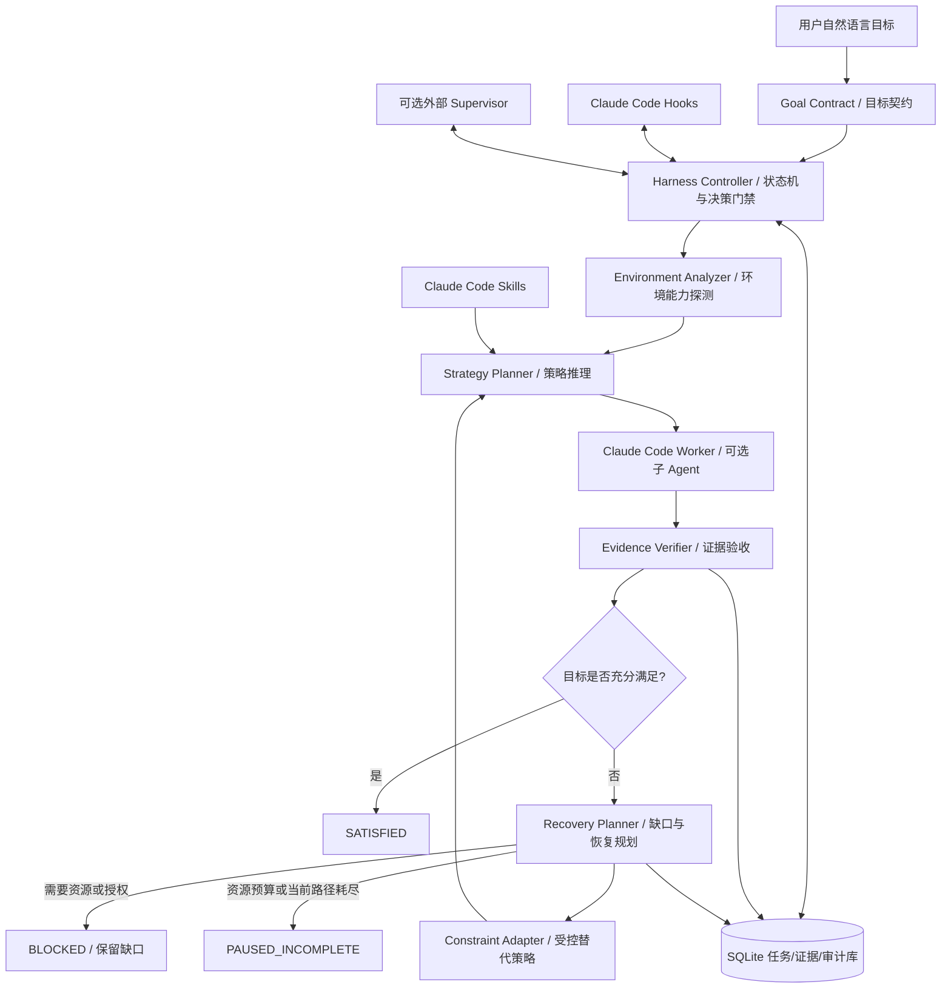

# RVD 2.0：跨 Agent 目标驱动 Harness 设计（Claude Code 首个适配实现）

> **文档类型**：架构设计与实施规格（可直接交给 Claude Code）  
> **版本**：v1.1｜2026-11-08  
> **目标交付物**：模型与平台无关的 RVD Core（目标契约、证据、状态机、恢复控制）；首个 Claude Code Plugin 适配器；可独立执行的本地验收与状态管理 CLI；可选的独立 Supervisor 进程。  
> **实现偏好**：Python 3.11+、SQLite、文件化契约；核心模块不引入 Claude Code SDK 类型或会话结构，Claude Code 通过官方 Plugin/Hook/Skill/Agent 接口集成；先本地、先单项目、先可验证，再扩展跨模型和长期运行。

## 0. 给实现 Agent 的任务说明

请将本文件作为**产品需求与架构约束**。首先实现平台无关的 RVD Core，再通过 Claude Code 官方接口集成首个适配器；先核对目标机器安装的 Claude Code 版本和官方 API。不要仅提交 Skill 文案、架构图或假数据演示；要有真实 Hook、持久化状态、验收执行、失败恢复和端到端测试。优先完成第 13 节的 P0；不要为追求一次性交付而省略验收。所有未完成项保留在状态库中；不得把“生成报告”“Agent 回复成功”“模拟器通过”等同于用户目标整体完成。遇到环境限制时必须探索替代路径，记录证据和剩余验证缺口；不能擅自放宽硬约束。

**一句话定义**：把“Agent 一次执行是否结束”与“目标是否已经得到充分验证”彻底分离；由持久化控制逻辑决定任务能否成功关闭，并让模型在策略受控的范围内自主寻找更好的执行和验证路径。

## 1. 背景与根本问题

已有的 RVD / Agent Quality Loop 强调规划、执行、独立验证、失败重试，却隐含了一个未经保证的假设：Agent 看见失败后会继续。真实反例是：Agent 开发软件后，测试全部失败，它诚实地产生失败表格并宣布本轮完成，整个系统也随之停止；缺失硬件时又直接声称“无法验证”，没有搜索交叉编译、模拟器、远程设备等替代方案。

这不是单纯的 Prompt 问题，而是**目标、执行、验收和生命周期被错误地绑定**：

- Agent 的回答结束 ≠ 项目目标完成；
- 遵守“如实汇报” ≠ 修复了报告中的问题；
- 原始测试方式不可执行 ≠ 目标不可验证；
- 模拟测试通过 ≠ 真实硬件验证通过；
- 当前环境受阻 ≠ 应该删除未完成目标；
- Harness“不轻易放弃” ≠ 无限重试或无条件绕过权限。

本项目把上述区别固化为可运行的机制，而不只是写进提示词。

## 2. 成功标准与非目标

### 2.1 必须实现的结果

1. **有据可验的成功**：只有预先约定的强制目标都有足够且有效的证据，系统才可标记 `SATISFIED`。
2. **失败不中断目标**：任务执行失败时保留 `Open Issues`，生成并实际派发恢复行动，不允许仅凭失败报告结束为成功。
3. **受控变通**：动态分析环境约束，自动考虑替代实现与验证方式，并审查它们能证明哪些目标。
4. **诚实的部分验证**：无法做真实硬件测试时，尽可能完成交叉编译和模拟测试，状态为 `PARTIALLY_VERIFIED` 或 `BLOCKED`，保留真实硬件验证缺口。
5. **持久恢复**：Agent 超时、退出或上下文丢失后，验收状态、失败原因、证据和下一步计划能够恢复。
6. **统一协议**：Skill、Hooks、验证 CLI、未来 Supervisor 读写同一套目标契约、证据记录与任务状态，而非各自理解“完成”。
7. **具备可观察性**：用户能查看“完成了什么、没完成什么、为什么、已经尝试什么、下一步是什么”，并能审计约束修改。

### 2.2 明确不做

首期不开发自有 IDE、UI、通用多 Agent 平台或新的模型网关；不强制所有项目采用一种编程语言；不承诺 24 小时无故障自主运行；不替用户批准需要授权的高风险操作；不让 LLM 的自我评分代替测试证据。

## 3. 总体设计与控制边界



三个控制层次必须明确：

- **Skill（认知层）**：教模型拆解目标、审视假设、寻找替代方案、分析失败、评估证据覆盖度。可引导，但不能保证被执行。
- **Hooks（会话门禁层）**：在 Claude Code 生命周期节点强制检查状态、拦截过早的任务完成、写入事件。能影响单次会话，但不能保证会话永久存活。
- **Controller（权威状态层）**：负责状态转换、授权、证据有效性、恢复队列、预算和任务终止条件；先以内嵌 Python CLI/库实现，后续由**可选外部 Supervisor** 跨会话调用。

**单一事实来源（Single Source of Truth）**：Goal Contract（目标与允许调整范围）+ Evidence Store（事实证据）+ Controller 状态。Agent 自己的自然语言总结只是待审查输入，不是权威状态。

## 4. 核心数据契约：目标、约束、证据、缺口

### 4.1 Goal Contract（项目级）

定义为版本化文件，建议放在仓库 `.rvd/goal.yaml`，并提供 JSON Schema 校验。最小字段：

| 字段 | 含义 |
|---|---|
| `goal_id`, `version`, `intent` | 目标 ID、版本、自然语言意图 |
| `requirements[]` | 每个可验证目标：ID、描述、强制性、验收谓词、证据要求 |
| `constraints[]` | 约束：`HARD`、`NEGOTIABLE`、`ASSUMPTION`，来源及变更权限 |
| `environment_assumptions[]` | 例如“假设存在 ARM 开发板”——事实待证，不等于硬约束 |
| `risk_policy` | 命令、网络、敏感数据、外部资源、付费、生产环境的授权策略 |
| `budget` | 尝试次数、运行时长、模型费用、并行度等上限 |
| `completion_policy` | 哪些 requirement 必须有何种证据才能完成 |
| `owner` / `amendment_log` | 契约归属、变更记录 |

**原则**：实现方法、测试工具、环境假设可以在授权范围内变化；产品必须具备的功能和重要安全要求不能被模型悄悄改写。新增“用模拟器替代真机”的方案，不等于把“真机性能达标”要求删除。

### 4.2 每项要求的验证状态

每个 requirement 至少有：`UNVERIFIED`、`IN_PROGRESS`、`VERIFIED`、`PARTIALLY_VERIFIED`、`FAILED`、`BLOCKED`、`STALE`；其中 `STALE` 代表代码或前置条件变化导致原证据不再有效。全局状态单独使用第 5 节的状态机，**不要混用项目成功与单项测试通过**。

### 4.3 Evidence Record（证据记录）

每个验证证据要有：`evidence_id`、`requirement_ids`、`method`、`environment_fingerprint`、`commit_or_artifact_hash`、`command_or_procedure`、`exit_code`、`timestamp`、`log_path`、`claim_supported`、`limitations`、`verifier`、`freshness/status`。必须明确“该证据证明了什么、不能证明什么”；日志和输出文件保留可访问路径及哈希，避免只保留 Agent 的文字判断。

验证强度按任务具体定义，不套用固定的“模拟器一定低于真机”评分。例如：编译兼容性可以由交叉编译充分证明；硬件性能必须有真实或经过证明等效的测量环境。**证据充分性是针对特定要求的关系，不是一个可随意相加的通用分数。**

### 4.4 Open Issue 与 Recovery Attempt

未满足项必须产生可追踪的 `issue_id`：根因假设、阻塞资源、影响的 requirements、建议行动、已尝试方案、执行代理/模型、观察到的差异、下次尝试条件、是否允许自动执行。相同根因的十项失败应聚类，防止机械创建十个重复任务。

## 5. 生命周期与状态转换

全局任务状态：

- `NEW`：目标契约尚未确认或初始化；
- `READY`：有可执行行动，等待派发；
- `RUNNING`：当前存在执行尝试；
- `VERIFYING`：独立校验结果与证据；
- `RECOVERING`：存在缺口，正在规划/执行恢复；
- `BLOCKED`：依赖未满足、需要外部资源/许可；保留开放问题；
- `PAUSED_INCOMPLETE`：预算、时间、当前可行路径耗尽；保留开放问题；
- `SATISFIED`：所有强制 requirement 的证据满足目标契约；
- `CANCELLED`：用户或授权控制层明确取消；
- `ERROR`：系统/数据库自身故障；不代表项目失败或成功。

状态转换只能经 Controller 的确定性规则提交；原子提交到 SQLite，附带操作者、事件来源、原因、证据引用和契约版本。

必须遵循的状态不变量：

1. `SATISFIED` ⇒ 所有强制要求证据充分、有效、未过期；若证据失效则重新打开相关要求。
2. Worker 报告、测试工具退出码、Hook 结束事件 **均不能直接将项目标记为 SATISFIED**。
3. `RUNNING → VERIFYING → RECOVERING` 属于正常路径；失败不自动转为终止。
4. 同一个尝试 ID 重放 Hook 事件不得重复派发任务；相同 issue 的恢复须幂等。
5. 不可执行或持续无信息增益时必须退避、换策略、升级阻塞，而不是热循环。
6. 用户明确停止、资源/安全预算触顶、权限未获批准时，不得用“持续恢复”绕过控制。

## 6. 关键决策：约束与验证如何自适应

新增一个**受控策略变更流程**，要求模型提出的是可审查的 `Strategy Proposal`，而不是直接修改验收标准：

`发现限制 → 定位受影响的 requirement → 区分限制类型 → 列举可行替代方案 → 推断各方案的证据覆盖 → 风险/成本/授权审核 → 执行最优可行方案 → 重新验证 → 保存剩余缺口`。

分类与决策权限：

| 约束类型 | 例子 | Harness 能否自行调整 |
|---|---|---|
| `HARD` | 不许泄密、必须真实硬件性能达标、禁止修改生产数据 | **不能**；需要明确的契约修订授权，否则保持阻塞 |
| `NEGOTIABLE` | 先用 pytest 还是集成测试、测试工具选择 | **可以**；记录前后差异和证据覆盖 |
| `ASSUMPTION` | “需要开发板才能开始测试” | **可以挑战**；经过探测证实/推翻，不能当成权威事实 |
| `ENVIRONMENT_FACT` | 沙盒确实没有 USB 设备、Docker/TUN 不可用 | **不能伪造**；可寻找别的环境或验证方法 |

对替代方案至少审查：能覆盖哪些要求、仍有哪些缺口、方法风险、成本、是否改变用户目标、是否越权、实际可执行性、可获得的信息增益。默认优先选择**有新信息且代价较低**的方案，不只是最容易“绿色通过”的方案。

### 案例：无 ARM 开发板

目标：为特定 ARM SoC 交付可工作的软件；某些要求是逻辑功能、交叉架构构建，另一些可能是设备驱动或硬件实时性能。

1. 探测到 `no_physical_arm_device`，归类为环境事实，而不是整体任务失败。
2. 产生候选：交叉编译、QEMU/用户态模拟、mock 设备层、远程 ARM 主机、借助 CI runner；先探测许可、网络、架构和可运行性。
3. 交叉编译成功只关闭“目标架构能构建”的要求；QEMU 中功能测试通过可关闭覆盖充分的逻辑要求；驱动行为/实机实时性能仍保持 `UNVERIFIED` 或 `BLOCKED`。
4. 产生 `needs_physical_hardware_validation` open issue，并附目前已完成工作的证据。
5. 资源可用时恢复真实硬件测试；没有资源时可交付“阶段性结果 + 未完成验收”，**不可声称整体完成**。

### 自动替代方法的防降标机制

任何建议修改验收谓词的动作必须形成 `Amendment Proposal`：原谓词、拟变更谓词、理由、风险、证据影响、授权角色；`HARD` 变更必须人审，模型和执行 Agent 不得自批。验证方式变更可自动审批，但需由独立验证器确认其对原 requirement 的覆盖，不能把 requirement 替换成更容易达标的新目标。

## 7. 失败恢复与模型调度

Recovery Planner 不应只数“重试次数”，还应比较本轮是否带来新信息：新日志、新错误定位、修复 patch、新假设、新验证路径、环境变化。失败策略：

- **代码缺陷**：根因诊断 → 最小修复 → 重跑相关测试 → 回归测试；
- **工具/环境问题**：探测替代工具 → 准备沙盒内可行工具链 → 探索远程执行（获得权限之后）；
- **缺少硬件**：转动态验证策略，输出覆盖矩阵和缺口；
- **验证方式失效**：修订验证方法，不修改原功能要求；
- **模型陷入循环**：检查恢复尝试的证据差异 → 改变问题分解/上下文 → 委托其他 Agent 或不同模型；
- **无可行路径**：`BLOCKED`/`PAUSED_INCOMPLETE`，保存可恢复条件和人工需要做的最小决策。

不强制每次调用三四个模型。建议只在“方案冲突、验证不充分、连续无增益、风险较高”时启动 Reviewer / Alternative Planner。不同模型优先用于**独立性**，同一供应商的多个 Claude 子 Agent 不等于跨厂商独立；跨 Codex/OpenCode 的适配放到后续 Supervisor，不要求 P0 解决。

定义有限预算：`max_attempts_per_issue`、`max_consecutive_no_progress`、`time_budget`、`cost_budget`、`parallelism`、`cooldown`；允许用户调整，但不能默认无限运行。

## 7.5 跨 Agent 统一机制与适配器边界（v1.1 新增）

**RVD 2.0 不是 Claude Code 专用流程**。Goal Contract、Evidence Store、状态机、Recovery Queue、Constraint/Verification Policy 都必须能在不启动 Claude Code 的前提下运行与测试。Claude Code Plugin 是首个用户入口和执行适配器，不能成为任务状态的唯一宿主。

### 7.5.1 平台无关 Core

- `GoalContract`：目标、硬约束、可变约束、验收要求、权限策略；由 Core 负责版本化与审计。
- `TaskController`：推进任务状态机，拒绝以文本报告或单次 Agent 退出码认定目标完成。
- `EnvironmentCapability`：以事实描述执行环境，可用工具、资源、限制和可访问的远程节点；不写入特定 Agent 的上下文格式。
- `EvidenceVerifier`：以能力、要求、证据、覆盖范围和有效期为输入给出可追溯的验收结果；不以厂商特定“完成”标志为依据。
- `RecoveryPlanner`：只产出结构化恢复任务及其依据；是否派发、是否变更约束由 Controller 审批。
- `SessionRegistry`：把一个目标关联到多个厂商会话/执行实例，保存外部 session ID、可恢复句柄和运行状态，不将 session ID 当作业务目标 ID。

### 7.5.2 AgentAdapter 标准接口

约定 `start_task(task_spec, context) -> execution_id`、`poll_or_wait(execution_id) -> status`、`collect_artifacts(execution_id) -> artifacts`、`request_resume(execution_id, instruction) -> outcome`、`cancel(execution_id) -> outcome` 等逻辑接口。各厂商允许能力不同：某个适配器不支持会话恢复时，应标记 `resume=false` 并启动新会话传递持久化上下文，不能假装恢复了原会话；不支持取消、Hook 或工具调用时同样显式报告能力差异。可用能力优先于统一外观。

适配器不直接修改权威验收状态，只能提交观察、报告、文件、工具日志和候选决策；Core 独立验证后更新 Goal Contract 对应的状态。外部 Agent 的消息、工具返回、日志、网页内容都作为潜在不可信输入，不能绕过权限和验收策略。

### 7.5.3 执行入口与降级路径

- **Claude Code**：优先使用插件、Hooks 和 CLI；`Stop`/`TaskCompleted` 可提供会话内门禁，但不替代 Supervisor。
- **Codex、OpenCode**：优先查验当前官方可用的 CLI/API、会话恢复、事件流等能力，再编写各自 Adapter；不得臆测其接口与 Claude Code 相同。
- **Qoder、WorkBuddy、豆包等桌面或网页 Agent**：先验证是否存在受支持的任务启动、读取产物和会话续接接口；如果缺失，只能做文件/会话元数据关联或显式人工接力，不依赖脆弱的私有协议或绕过账号权限。

### 7.5.4 统一而非同质化

统一的是**目标 ID、需求与证据 ID、状态语义、恢复任务协议、权限和审计**，不是厂商的消息格式、工具调用格式或所有 Agent 的内部循环。平台无关 Core 不得依赖某个模型能“自觉继续”，也不能以 Hook 是否执行作为目标完成的证明。

新增跨适配器验收：同一个 Goal Contract 可以先由 Claude Code 执行，再由另一适配器续做；即使原会话已退出，Core 仍保留未完成项、证据关联和下一步计划。至少提供 Mock Adapter 测试这一路径，不强制 P0 同时集成多个厂商。

## 8. Claude Code 首个适配器：插件接口设计（按官方机制）

Plugin 是分发载体，不是取代 Claude Code 自身运行时。主要接口如下：

| 组件/事件 | 本项目职责 | 必须注意的边界 |
|---|---|---|
| `skills/.../SKILL.md` | 目标拆解、障碍分析、替代验证、恢复步骤 | 是行为指导，不是硬控制 |
| `SessionStart` | 读取当前项目目标和开放问题，注入简短状态上下文 | 不能用来阻止会话结束 |
| `TaskCompleted` | 阻止尚不满足验收的 Claude Code Task 被标为完成 | `exit 2` 可拒绝任务完成；不是全局长期控制器 |
| `Stop` | 会话本轮结束前检查全局目标；有可执行恢复方案时反馈继续 | 官方存在连续继续保护上限，且不覆盖用户中断、API 异常 |
| `SubagentStop` | 获取子 Agent 结果并记录/复核；必要时反馈继续 | 不能假定子 Agent 结束就是总目标完成 |
| `PostToolUse` / `PostToolUseFailure` | 轻量记录关键测试和失败事件 | 避免对所有工具同步跑重测试 |
| `PreToolUse`（按需） | 防止未经授权的危险操作或修改受保护的契约文件 | 不应自行扩大 Claude Code 的权限 |
| `StopFailure` | API、限流等异常日志与恢复提示 | 不可阻止错误导致的结束 |
| `SessionEnd` | 清理租约、刷盘、写检查点 | 不能阻止会话退出，必须由外部进程决定是否重启 |

官方 `Stop` 使用 `decision: "block"` + `reason`，或非错误反馈 `additionalContext`；应检查 `stop_hook_active`，注意连续继续次数的保护机制。**不能靠在 Hook 中无限递归调用 Claude Code 来模拟外部守护进程。**

Hook 程序应尽量快：读取快照、执行轻量检查、返回决策；耗时的构建或测试应作为被管理的执行任务运行，之后把证据写入状态库。Hook 超时或依赖损坏时，应记录 `ERROR`，不产生“验证通过”假象；如果无法强制拦截当前退出，依靠下次启动与外部 Supervisor 恢复，不假定 Hooks 永远生效。

注意 `TaskCompleted` 只针对 Claude Code 的 Task 生命周期事件，**不是**自动代表任何用户自然语言目标或全部子任务都触发了该事件；全局完成仍以 Controller 状态为准。

## 9. 首个插件建议目录与统一项目状态

```text
rvd-harness/
  .claude-plugin/
    plugin.json                 # 元数据；不要在此目录放其他组件
  hooks/
    hooks.json                  # 官方 Hook 事件配置
  skills/
    rvd-init/SKILL.md           # 初始化/解释目标契约
    rvd-run/SKILL.md            # 依据开放问题持续执行
    rvd-recover/SKILL.md        # 根因、替代策略与恢复
    rvd-status/SKILL.md         # 查看当前证据和缺口
  agents/
    goal-planner.md             # 要求拆解与边界识别
    evidence-verifier.md       # 独立验证者
    recovery-planner.md        # 失败和环境适配
  scripts/
    hook_entry.py               # Hook 统一入口（stdin JSON）
  rvd_core/
    contracts.py               # 契约和 Schema
    state_machine.py           # 状态机与门禁
    storage.py                 # SQLite/事务
    environment.py             # 环境探测
    evidence.py                # 验证执行与证据规则
    recovery.py                # 恢复策略管理
    cli.py                     # 管理 CLI
  schemas/
    goal.schema.json
    evidence.schema.json
  tests/
    fixtures/                  # 模拟 Claude Hook 事件
    unit/
    integration/
    scenarios/
  docs/
    installation.md
    operations.md
    design-decisions.md
```

项目仓库中存储：

```text
<project>/.rvd/
  goal.yaml                    # 可审计的用户目标和验收契约（可纳入 Git）
  policy.yaml                  # 项目策略与预算（可纳入 Git）
  .gitignore                   # 忽略 state.db、运行日志及敏感数据
  state.db                     # 实际状态/证据索引，默认本地不提交 Git
  evidence/                   # 日志、测试结果、执行记录，含哈希
  reports/                    # 给用户的阶段性报告，非成功门禁
```

插件自身代码必须与工作项目状态分离。状态路径应有配置覆盖，支持多个项目，严禁把数据库写到插件安装/缓存目录；工作目录变化时，依据明确的项目根标识选择数据库，不因 `cwd` 改变而写错项目。敏感日志需要脱敏或受控访问。

## 10. 对外的最小交互契约

先通过 Python CLI 提供确定性接口，供 Hooks、Skills、未来其他模型一致调用：

```text
rvd init                 # 从用户目标建立目标契约；必要时要求确认硬约束
rvd status               # 状态、证据、开放问题、下一步
rvd verify               # 对要求执行/汇总适用的验收检查
rvd next                 # 返回下一项允许执行的动作（机器可读 JSON）
rvd issue list           # 查看未解决问题
rvd recover <issue-id>   # 生成/执行授权范围内的恢复候选
rvd amend propose       # 提议契约修订，记录差异
rvd amend approve       # 仅经明确授权者确认后生效
rvd report               # 生成“通过、部分验证、未验证、受阻”报告
rvd doctor               # 检查环境、Hook、项目状态与配置
```

MVP 只需实现 `init/status/verify/next/report/doctor` 与恢复记录所需的内部能力；其余命令在 P1/P2 分阶段交付。命令要提供 `--json` 方便脚本解析，错误码稳定、与 stdout/stderr 分离。插件 Skills 是用户友好的命令入口，如 `/rvd-harness:rvd-status`；权威状态写入由 CLI 完成。

Controller 与模型之间尽量只交换结构化结果：`execution_result`、`evidence_assessment`、`strategy_proposal`、`recovery_decision`，而不是让模型直接编辑 SQLite。所有模型输出按 Schema 校验，重要字段不完整时回退为 `UNVERIFIED`，不是默认通过。

## 11. 决策流程（运行时）

一轮完整闭环：

1. **Init**：把用户需求分解为要求、硬约束、可调整假设及验收谓词，生成 Goal Contract。模糊的不可逆安全/交付标准由用户确认；普通实现路径由系统选择。
2. **Discover**：主动探测本地与可用远程资源；验证用户给出的环境假设。
3. **Plan**：从未验证要求中选择高价值行动；提出执行方式与预计证据覆盖，检查授权和预算。
4. **Execute**：委托 Worker 实现或运行测试；记录尝试 ID、代码版本、环境指纹。
5. **Verify**：独立验证 CLI 运行确定性检查；Reviewer 可补充分析，但不能凭语言宣布成功。
6. **Decide**：若所有强制要求满足，进入 `SATISFIED`；否则形成未完成问题，进入 `RECOVERING`。
7. **Adapt**：评估失败是代码、环境、证据缺口还是错误假设；探索有信息增益的替代方案。可授权则执行，不能授权则 `BLOCKED`。
8. **Persist**：每步以事件写入数据库；停止、超时或进程退出不丢失目标和恢复队列。

防止自我欺骗的两道独立检查：**“证据真实性”**与**“证据是否足以覆盖目标”**。成功判定最好由规则与测试实现；模型适用于解释、设计和解决“如何取得证据”的开放问题。

## 12. 安全、可靠性与操作约束

- 不绕过用户/组织设置的 Claude Code 工具权限；外部 Supervisor 也不能暗中扩大权限。
- 付费资源、访问外部账号、下载不可信镜像、远程执行、删除文件、生产变更等按策略明确审批；普通本地只读探测或隔离测试可按授权策略自动化。
- 用户主动取消或手动停止优先级高于自动恢复；暂停后不得自行重启。
- 避免“成功标准漂移”：契约版本变更必须在审计日志中引用授权和理由；Agent 不能把 `HARD` 改成 `NEGOTIABLE` 来获得绿色结果。
- 防止循环：相同根因和相同策略无新证据时必须退避；多次失败后不是直接放弃，而是找新路径或进入有记录的 `BLOCKED`。
- 同一任务多进程竞争时使用租约/数据库事务，避免并发执行破坏性任务和重复记账。
- 采用数据版本与迁移，避免升级插件时破坏已有 `.rvd` 项目；离线时可继续本地分析与适用测试。
- 如果 Hook 无法加载、被关闭或遇到超时，**不能保证拦截 Claude Code 的终止**；必须在报告中明确该保障降级，外部 Supervisor 才能提供进一步的跨会话恢复。

## 13. 分阶段开发计划与验收（先 Core，再 Claude 适配器）

### P0：单会话可靠闭环——必须优先交付

**范围**：可安装 Plugin、目标契约、最简 SQLite 状态、`SessionStart` + `Stop` + `TaskCompleted` Hooks、可执行验证 CLI、未完成 Issue 保留、最小恢复提示、示例项目。

**验收：**

- 运行 `claude plugin validate <插件目录>` 成功；使用 `claude --plugin-dir <插件目录>` 能加载 Skill 和 Hooks。
- 模拟 Worker 生成“测试全部失败，但工作已完成”报告；`TaskCompleted` 不允许任务被标为完成，`Stop` 通过官方支持的反馈方式要求继续；数据库保留失败证据和开放问题。
- Worker 真正修复并通过预定测试后，独立 verifier 记录证据；只有强制要求全满足才进入 `SATISFIED`。
- 对 Hook 保护上限、主动中断、API 失败等场景，不能误报成功；必须持久化为未完成或错误状态。
- 插件禁用时不声称仍有 Hook 级阻止保证；`rvd doctor` 能发现该情况。
- 单元测试验证状态机不变量、数据库幂等、契约版本与证据过期。

### P1：环境自适应与失败恢复

**范围**：环境探测、约束分类、替代验证方案、验证覆盖矩阵、Recovery Planner、策略提案与审批、独立 Reviewer（按需）、无信息增益识别。

**验收：**

- 注入“没有 ARM 硬件”场景，能够主动评估交叉编译、模拟器、远程资源的可行性，且实际运行至少一种当前环境可用的替代验证；若安装/访问条件不允许，解释原因并保留下一步。
- 模拟器通过不自动关闭明确要求实机验证的 requirement；能生成 `PARTIALLY_VERIFIED` 与缺口报告。
- 连续重复相同失败时能够识别无信息增益，切换路径或有理由地暂停；不会无限热循环。
- 所有约束变更都生成可审计 Proposal；未经授权不可放宽硬约束。

### P2：外部 Supervisor 与跨会话恢复

**范围**：独立 Python 监督器、任务队列、CLI/Agent SDK 执行适配、会话 ID 和运行结果追踪、指数退避与限流、恢复检查点、人工停止与权限处理。

**验收：**

- Claude 会话异常退出后，Supervisor 在**用户授权的运行策略和预算内**恢复任务；数据库状态未丢失。
- 中断、取消、权限拒绝与限流分别得到正确处理：取消不重启；权限拒绝不绕过；限流有退避和预算上限。
- 重启后不重复派发已经成功的动作；报告显示每次尝试、证据、状态和恢复原因。
- 支持至少一种明确的非交互式调用方式（`claude -p` 或 Agent SDK）；不能把内置 Hook 的连续继续能力当成外部 Supervisor。

### P3：跨模型/多 Agent 与长期项目管理（可选）

**范围**：Codex/OpenCode 等适配器，验证者模型可与执行者异构；跨厂商会话引用；可视化状态服务；远程节点资源发现。

**验收**：相同 Goal Contract、State Store 和 Evidence Schema 在至少两种不同执行后端下正常工作；不同模型输出必须经过同一证据门禁。无模型可用时不丢失状态，也不得“自动成功”。

## 14. 必须构建的端到端测试场景

| 场景 | 期望结果 |
|---|---|
| A. 10 项测试全部失败，Worker 提交失败表格 | 状态非 `SATISFIED`；存在 open issues 和实际恢复动作 |
| B. 10 项中 8 项通过、2 项失败 | 仅已验证的 8 项关闭，剩余两项进入恢复队列 |
| C. 无真实 ARM 设备，可用交叉编译与模拟器 | 尽量执行替代验证；实机相关要求继续开放 |
| D. 仅模拟器通过，但目标要求真实设备性能 | 不允许整体成功，必须标注不能替代的证据缺口 |
| E. 连续多次重复同一错误、无新日志或方法 | 转为其他恢复策略，或受控暂停，不热循环 |
| F. Hook 被禁用、超时、错误、保护上限触发 | 不得报成功；状态保留，错误可诊断 |
| G. Claude API 限流或崩溃 | 非成功状态持久化；P2 才要求外部恢复 |
| H. 用户拒绝下载镜像/远程运行/付费服务 | 不绕过权限；记录可行的低风险替代方案或阻塞 |
| I. Worker 尝试偷偷修改硬约束/验收谓词 | 变更不生效；记录审计；状态仍按原契约评估 |
| J. 代码变更后重复使用旧测试通过报告 | 检查 commit/hash/环境，证据过期后要求重验 |
| K. 两个 Hook 或进程重复收到同一完成事件 | 幂等处理，不重复执行或重复写证据 |
| L. 用户主动取消任务 | `CANCELLED`，外部 Supervisor 不得擅自重启 |

## 15. 实施准则：如何避免“形式完成”

Claude Code 实现此方案时，必须交付并展示：

1. 安装与运行步骤，说明支持的 Claude Code 版本以及已经验证的版本；
2. 插件实际文件及 Hook 配置，不能只做文档；
3. 状态库结构/迁移和 Goal Contract 的 Schema，至少一份真实示例；
4. 两套可重复的场景：**失败报告被拦截并推进修复**、**无硬件时执行替代验证但不伪造实机通过**；
5. 自动化测试结果和关键日志，区分真实运行与 mock 结果；
6. 已知限制及未完成项清单，明确哪些依赖 P1/P2；
7. 最终演示报告必须是依据真实验证证据生成的，不是让另一模型阅读源码后给出“全部通过”。

任何阶段只有“计划写完了”“Skill 写完了”“结果如实报告了”都不能满足该阶段验收；**实际 Hook 行为和对应状态变化**才是可接受的交付证据。

## 16. 设计取舍与建议优先级

建议首版优先完成四个硬能力：**Goal Contract、可执行 Evidence Verifier、Stop/TaskCompleted 门禁、SQLite Open Issue 持久化**。在此基础上，加入 Recovery Planner 与环境自适应；真正跨会话的持续运行再交给 Supervisor。不要先构建复杂多模型调度器，否则会产生更多“Agent 报告完成但无人负责验收”的路径。

最值得坚守的设计原则是：**目标尽量稳定、方法可以适应、证据必须真实、未完成必须留下、恢复必须有信息增益、停止必须有依据。**

## 17. 参考资料（实现前重新核对安装版本）

以下是截至 2026-11-08 核对的 Claude Code 官方文档，具体 Hook 事件/字段以目标环境实际版本为准：

- Plugin 概览：<https://code.claude.com/docs/en/plugins>
- Plugin 创建与本地验证：<https://code.claude.com/docs/en/plugins/create>
- Plugin manifest 与标准目录：<https://code.claude.com/docs/en/plugins-reference>
- Hooks，尤其 `Stop`、`TaskCompleted`、`SessionEnd`、`StopFailure`：<https://code.claude.com/docs/en/hooks>
- Skills：<https://code.claude.com/docs/en/skills>
- 非交互式调用与恢复会话：<https://code.claude.com/docs/en/headless>

> **实施顺序提示**：先 P0 做出可验收闭环，再 P1 解决“环境不允许时如何变通”，最后 P2 解决“会话确实退出后如何继续”。每个阶段都需要独立可运行的验证结果，不能以文档代替实现。