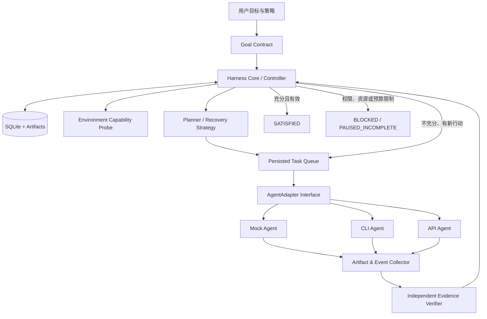

# RVD 2.0 — 通用 Agent Harness：产品、架构与实施规格

> 文档版本：2.0（2026-11-08）  
> 文档用途：**给任意具备软件开发能力的 Agent、开发团队或自动化编程系统直接实施**。  
> 适用范围：本地 CLI Agent、非交互式编程 Agent、提供正式 API 的 Agent、可被进程包装的自定义 Agent。  
> 核心要求：**不依赖 Claude Code、Codex、OpenCode 或任何特定厂商的 Hook、Skill、模型 API、会话格式。**  
> 交付形态：可独立运行的 `rvd` Core/CLI、SQLite 持久化存储、Mock Agent、验证执行器、任务调度/恢复控制器、端到端测试；后续通过 Adapter 接入实际 Agent。  
> 首选工程栈：Python 3.11+、SQLite、JSON Schema、pytest；允许在保持协议与验收不变的情况下使用同等方案。

---

## 0. 给实施 Agent 的执行指令（从这里开始）

你接到的是**实现一个可运行项目**的任务，而不是编写新方案或模拟报告。请遵守：

1. 本文件是自包含需求基线；不要要求用户提供之前的聊天记录，也不要把本文件依赖于任何外部设计文档。
2. **先独立实现 Harness Core，再实现 Mock Agent；优先跑通 P0 的真实闭环**，之后按阶段扩展。实际 Agent 适配器只可使用其已确认、受支持的 CLI/API。
3. 所有“完成”判断必须来自 Core 的可核验规则及证据，而非 Worker 文本总结。Worker 退出、写完计划、生成失败表格，只代表**一次执行结束**。
4. 发生失败，应先记录开放问题，再提出有信息增益的恢复行动并实际派发；不得仅如实汇报失败就宣告成功。
5. 环境不满足原计划时，分析替代执行与验证路径；**可改变方法，不得偷偷修改不可放宽的目标、安全/质量约束**。
6. 无法完全验收时输出 `BLOCKED` 或 `PAUSED_INCOMPLETE` 及可恢复条件；不虚构通过；不无限空转；不越权调用网络、外部服务或付费资源。
7. 必须提交可运行源码、测试、示例、操作说明及逐项验收证据；**禁止用伪造日志、Mock 成功冒充真实后端集成通过**。
8. 有未解决设计细节时，优先选取最小、可测试、安全的实现，记录 ADR；仅在影响硬约束或授权边界时要求人工决策。

**成功定义：Harness 能持续持有目标，在 Agent 失败/退出后独立验证、创建恢复任务、重新派发；只有证据充分满足目标时才宣布整体成功。**

## 1. 背景、问题与非目标

常见失败模式：用户要求交付软件，Agent 完成了若干代码修改并生成测试报告；测试表格甚至全为“不通过”，但 Agent 仍结束对话并认为工作已做完。另一个常见场景是沙盒没有物理硬件、Docker、TUN 或外网权限，Agent 直接得出“无法验证”，没有探索交叉编译、模拟器、mock、受支持的远程测试或替代证据。

根因不是“报告不诚实”，而是**业务目标生命周期**、**单次 Agent 执行生命周期**、**验证证据**与**运行环境约束**被错误地混为一谈。

本项目要解决：目标持续存在；执行失败不等于目标结束；验证方式适应环境；恢复任务可以跨 Agent/跨进程重启；完成判定可审计、可重现。

首期不做：自有 IDE、模型网关、模型训练、通用云调度平台、全自动生产部署、浏览器账号自动化破解、对不支持编程接口的第三方产品进行私有协议逆向。**不承诺“永不失败”，而是保证失败状态不被错误地当作成功。**

## 2. 不可妥协的设计原则

| 编号 | 原则 | 工程含义 |
|---|---|---|
| P-01 | Core 与厂商解耦 | Core 在**未安装任何 AI Agent** 时可独立运行与完成全部单元/模拟集成测试 |
| P-02 | 外部控制权 | Core 调用 Worker，而不是仅靠 Worker 自觉遵循提示词、Hook 或 Skill |
| P-03 | 统一契约，非统一内部实现 | 统一任务/证据/状态/权限/事件 Schema；不统一各厂商原生消息格式 |
| P-04 | 执行完成≠目标满足 | 只有验证器及状态机可提交 `SATISFIED`；Worker、Adapter、Hook 无权直接提交 |
| P-05 | 目标稳定、策略自适应 | 工具、环境、执行方案、验证方式可以变；硬性需求及风险边界不可擅改 |
| P-06 | 证据覆盖逐项判断 | 每个 requirement 指明什么证据可证明它，不用总分掩盖关键缺口 |
| P-07 | 失败要推进但不热循环 | 失败后必须生成恢复/阻塞结论；无增益需换路径或暂停；有限预算 |
| P-08 | 持久、幂等、可恢复 | 崩溃、超时、进程被杀后恢复状态与待办，不重复执行已确认的副作用 |
| P-09 | 安全优先 | 未批准的危险操作、付费、发布、外部账号访问不得以“自主恢复”为名绕过 |
| P-10 | 可证伪的交付 | 每一里程碑必须由真实进程执行的可重现测试证明，不能只给文档 |

## 3. 概念模型与架构

### 3.1 核心对象

- **Goal**：用户希望达成的最终结果，属于项目级，不等同一次 Session。
- **Requirement**：可验证的具体结果及证据要求；可区分 mandatory/optional。
- **Constraint**：实现、环境、风险与验收限制；具有来源、类型、修改权限。
- **Task**：为 Goal 推进而产生的可调度行动；任务完成不代表 Goal 完成。
- **Execution / Attempt**：某个 Agent/工具的一次执行，拥有独立 ID、输入、产物、退出状态。
- **Evidence**：与特定 requirement、版本、执行环境、验证过程关联的可追溯证据。
- **Issue**：当前要求尚未满足的原因与缺口，可关联恢复任务和多次 Attempt。
- **Strategy Proposal**：修改执行方法/验证方法的候选提案，而不是更改最终需求的直接命令。
- **Amendment**：目标契约的正式变更，需要按权限审批。
- **Adapter**：将抽象任务映射为某种 Agent 的启动、状态、产物、取消、恢复接口。

### 3.2 逻辑架构



**Core 是权威边界**：Agent 可以提出代码、测试、修复、环境替代方案，不能直接改写成功标志；证据记录必须被校验和关联。可选的 Hook/Skill 只是增强使用体验，不是安全或正确性基础设施。

### 3.3 三种门禁必须区分

1. **内部 Hook 门禁（可选）**：某些 Agent 支持终止前回调，可提前提示继续；缺失时不影响外部门禁。
2. **执行回合门禁（必需）**：Harness 在每次 `run()` 返回后，检查实际产物和验证证据，决定重试、恢复、暂停或最终成功。
3. **跨进程生命周期门禁（P2）**：独立 Supervisor 监听持久化任务，Agent 意外结束后依授权和预算恢复；单次执行控制不足以保证跨进程连续运行。

## 4. 统一契约与数据语义

### 4.1 Goal Contract（版本化）

建议项目工作区结构为 `.rvd/goal.yaml` 和 `.rvd/policy.yaml`；提供 JSON Schema，核心字段如下：

```yaml
schema_version: "1.0"
goal_id: "goal-arm-service"
intent: "交付能在目标 ARM 平台运行的服务"
requirements:
  - id: "r-build"
    mandatory: true
    description: "可以为指定 ARM 架构构建"
    acceptance:
      predicate: "build_exit_code == 0"
      accepted_evidence_methods: ["cross_compile"]
  - id: "r-function"
    mandatory: true
    description: "核心协议功能通过预定义测试"
    acceptance:
      predicate: "integration_suite_passed"
      accepted_evidence_methods: ["native_test", "emulated_test"]
  - id: "r-device-performance"
    mandatory: true
    description: "真实目标设备的性能满足阈值"
    acceptance:
      predicate: "measured_p99_ms <= 20"
      accepted_evidence_methods: ["physical_device_measurement"]
constraints:
  - id: "c-safety"
    type: HARD
    description: "不得更改生产环境"
  - id: "c-device"
    type: ASSUMPTION
    description: "开发环境具有 ARM 设备"
budget:
  max_attempts_per_issue: 5
  max_no_progress_attempts: 2
  max_wall_minutes: 90
policy:
  allow_network_probe: false
  allow_external_download: false
  require_approval_for: ["paid_resource", "production_change", "remote_execution", "untrusted_download"]
```

上例用于演示数据语义，不要求 P0 实现通用字符串表达式 `eval`；**禁止直接执行契约中的任意 Python/JS 字符串**。验收谓词应映射至注册的、安全受控的 verifier 插件，或解析有白名单的受限 DSL。文档示例与运行时 Schema 必须保持一致。

### 4.2 约束分类与权限

- `HARD`：用户明确必须满足的功能、隐私、安全、生产变更限制；未经明确授权不得调整。
- `NEGOTIABLE`：构建/测试工具、执行顺序、可替换路径；可以在授权范围自动变更，留下审计记录。
- `ASSUMPTION`：比如“必须有硬件才能做任何测试”；需探测事实，可推翻。
- `ENVIRONMENT_FACT`：当前无硬件、不可用 TUN、网络受限等事实；不可伪造，只能寻找其他实现环境或验证路径。

不能把“没有硬件”直接等同于“用户允许取消硬件性能验收”。若确实存在真实硬件相关的 mandatory requirement，只可做阶段性部分交付，或申请正式修改目标契约。

### 4.3 Evidence Record

最少包含：`evidence_id`、`goal_id`、`requirement_ids`、`attempt_id`、`method`、`verifier_id/version`、`artifact_hash/commit`、`environment_fingerprint`、`command_or_procedure`、`exit_code`、`timestamp`、`artifact/log_path`、`claims_supported`、`limitations`、`validity_status`。

- 所有证据关联被验证的**代码版本和执行环境**；源码/配置变化可能使证据标记 `STALE`，需重验。
- 进程退出 0 仅表示命令成功退出；是否证明 requirement 由 verifier 的独立规则决定。
- 模拟器不是整体意义上的“低等级证据”：对逻辑功能可能充分，对真实设备性能通常不充分；覆盖关系逐项配置。
- 默认 `UNVERIFIED`；遇到未知日志、不可访问文件、损坏哈希或缺少验证器时，不能默认通过。
- Test Runner 应保留 stdout/stderr、退出码、超时/信号、命令/参数的脱敏表示与产物摘要。

### 4.4 状态层级

Requirement：`UNVERIFIED`、`IN_PROGRESS`、`VERIFIED`、`PARTIALLY_VERIFIED`、`FAILED`、`BLOCKED`、`STALE`。

Goal：`NEW`、`READY`、`RUNNING`、`VERIFYING`、`RECOVERING`、`BLOCKED`、`PAUSED_INCOMPLETE`、`SATISFIED`、`CANCELLED`、`ERROR`。

Attempt：`CREATED`、`STARTING`、`RUNNING`、`SUCCEEDED`、`FAILED`、`TIMED_OUT`、`CANCELLED`、`LOST`；**Attempt 的 `SUCCEEDED` 绝不等于 Goal 的 `SATISFIED`**。

### 4.5 必须成立的不变量

1. `Goal == SATISFIED` 当且仅当全部 mandatory requirements 均被**当前有效、覆盖充分、未过期的证据**证明，且无违反的硬约束。
2. 任何 Worker/Adapter/LLM 只可提交 candidate evidence 与 proposal；不可直接修改 Goal 状态。
3. 修改验收标准必须产生 Amendment 与授权痕迹；不能在恢复过程中静默降低门槛。
4. 已发现但未解决的 Issue 必须保留为 open / blocked，并与后续任务关联；报告文件不是解决证据。
5. 同一个事件或 Attempt 完成结果重复消费，不得重复派发或重复提交成功。
6. 用户取消、权限拒绝、风险策略/预算上限触发，优先于自动恢复；不可因为“持续完成目标”而绕过。
7. “没有新信息的重复尝试”必须有上限并更换策略或进入带原因的暂停状态。
8. 外部状态变化后，`SATISFIED` 可以因证据失效而重新打开相关 requirement；历史记录不可改写。

## 5. AgentAdapter 统一接口

Adapter 是传输和执行包装层，**不是验证决策者**。接口按语义设计，而非绑定某个具体 SDK：

```python
class AgentAdapter(Protocol):
    def capabilities(self) -> AdapterCapabilities: ...
    def start(self, task: TaskSpec, context: ExecutionContext) -> ExecutionHandle: ...
    def wait_or_poll(self, handle: ExecutionHandle, timeout_s: float) -> ExecutionSnapshot: ...
    def collect(self, handle: ExecutionHandle) -> ExecutionResult: ...
    def cancel(self, handle: ExecutionHandle) -> CancelResult: ...
    def resume(self, handle: ExecutionHandle, context: ExecutionContext) -> ExecutionHandle: ...
```

`capabilities` 必须显式提供 `non_interactive`、`resume`、`cancel`、`stream_events`、`tool_events`、`artifact_collection` 等布尔/枚举能力；**不支持就返回不支持，不得虚构统一性**。必要时 `resume` 应抛出 `UnsupportedCapability`，Controller 用新的 Attempt 携带持久化上下文继续，而不是假称恢复了原厂商会话。

`TaskSpec` 必须含 goal/task ID、工作目录、输入指令、可用资源、授权/预算、期望产物、deadline 与关联 Issue；`ExecutionResult` 必须含 exit/reason、时间、可验证产物位置、可选外部 session ID、原始输出引用和失败分类。不要让 Adapter 的返回值成为 SQL UPDATE `SATISFIED` 的入口。

首个 `MockAgentAdapter` 支持确定性脚本：第一次写入失败测试结果、第二次产出修复后通过结果；可注入超时、崩溃、产物缺失、重复事件、无进展，用于闭环测试。Mock 不是实际模型：报告里必须明确 `backend=mock`。

真实 CLI/API Adapter **必须单独验证其当前正式接口**；不把某个模型的运行标志、Hook、事件格式写入 Core。无法控制或读取的第三方桌面 Agent，最多支持显式人工接力/结果导入，不承诺自动调度。

## 6. 外部验收与恢复控制循环

**控制循环的基本流程**：

```text
LOAD Goal + state
 → DISCOVER environment
 → SCHEDULE next authorized task
 → START AgentAdapter / ToolRunner
 → COLLECT artifacts and exit reason
 → VERIFY requirements using independent verifiers
 → IF all mandatory verified: SATISFIED
 → ELSE diagnose gaps and classify issues
 → PROPOSE recovery strategies, evaluate risk/coverage/cost/information gain
 → IF authorized and feasible: enqueue next attempt; repeat
 → ELSE: BLOCKED or PAUSED_INCOMPLETE (retain state and resume trigger)
```

实现约束：

- Verifier 运行在 Harness 受控进程中；不要只让同一 Worker 自述“测试已通过”。
- 失败恢复需要至少分类：实现缺陷、测试缺陷、工具/依赖不可用、环境缺失、证据缺口、权限不足、执行超时、模型重复无增益。
- 同类 Issues 可合并根因，但不可丢失各 requirement 的覆盖关系。
- `RecoveryPlanner` 输出结构化、可审计提案：`issue_id`、`hypothesis`、`next_action`、`expected_evidence`、`alternatives`、`cost/risk`、`permissions_required`、`progress_signal`、`fallback`。
- 调度依据包含**信息增益**：是否有新日志、新假设、新修复、新环境、新测试方法；连续同样失败不应只改提示词重复跑。
- 不要求每个步骤都调用“最强模型”或多模型投票；当证据冲突、反复失败、高风险或策略不确定时可派发独立 Reviewer/Planner。
- 超时至少区分 Agent 进程等待超时、整个执行超时、工具超时、任务总预算；不可把等待超时直接当成执行失败或取消成功。

### 6.1 环境自适应的参考案例

目标：交付 ARM 设备上的服务。当前沙盒没有真实设备。

1. 发现环境事实 `arm_device=false`，不是终止依据。
2. 分解目标：构建兼容性、协议逻辑、设备驱动、真实环境时延。
3. 考察交叉编译、QEMU user/system、mock I/O、可访问的远程 CI/设备；逐项评估可执行性、安全授权与证据覆盖。
4. 自动使用**已被授权且可用**的本地替代方法进行部分验证。
5. 保留真实驱动/实机时延要求为 `BLOCKED` 或 `UNVERIFIED`，记录资源就绪时的重启条件。
6. 如果用户已明确授权采用经过定义的替代验收，则根据契约版本更新完成规则；否则不更改目标。

### 6.2 完成决策（伪代码）

```python
while controller.can_run(goal):
    task = controller.next_authorized_task(goal)
    if task is None:
        controller.pause_with_reason(goal)
        break

    result = adapter.execute(task)  # 单次执行可失败/超时
    controller.persist_attempt(result)
    evidence = verifier.verify(task, result)
    controller.persist_evidence(evidence)
    controller.refresh_requirements(goal)

    if controller.all_mandatory_requirements_verified(goal):
        controller.transition(goal, "SATISFIED")
        break

    issues = controller.upsert_open_issues(goal, evidence)
    proposals = recovery.plan(issues, controller.environment())
    controller.enqueue_only_authorized_useful_actions(proposals)
    # 无授权可执行行动时，受控阻塞/暂停，而不是循环
```

伪代码不构成实际实现中的 `adapter.execute` 同步 API 约束；进程管理可拆为 `start`、`poll`、`collect`。所有 Controller 写操作应在 SQLite 事务中完成，使用稳定 ID 和幂等键。

## 7. 存储、进程边界与故障恢复

建议目录：

```text
rvd-harness/
  pyproject.toml
  rvd_core/
    contracts.py
    state_machine.py
    store.py
    scheduler.py
    environment.py
    evidence.py
    verification.py
    recovery.py
    policy.py
    cli.py
    adapters/
      base.py
      mock.py
  schemas/
    goal.schema.json
    event.schema.json
    evidence.schema.json
    proposal.schema.json
  tests/
    unit/
    integration/
    e2e/
    fixtures/
  examples/
    failing-tests/
    arm-without-hardware/
  docs/
    QUICKSTART.md
    ARCHITECTURE.md
    OPERATIONS.md
    ADR/
```

每个受管工作区独立保存：

```text
<project>/.rvd/
  goal.yaml             # 建议版本管理，审批修改
  policy.yaml           # 预算、资源、授权、后端选择
  state.db              # SQLite，本地状态，默认不要提交 Git
  evidence/             # 证据日志与哈希、测试产物
  reports/              # 人读报告，不能当作成功条件
  checkpoints/          # 可选恢复上下文
```

P0 可采用单进程 Worker；仍须为后续 Supervisor 预留 lease/attempt 状态。至少持久化 Goal、Requirement、Task、Attempt、Evidence、Issue、StrategyProposal、Amendment、Event、Approval。数据库迁移用 `schema_version`，事件流带 event ID、时间、主体、前/后状态、原因、事务标识；敏感内容脱敏，不记录令牌原文。

恢复要覆盖：启动前退出、执行中进程被杀、写入尝试结果后崩溃、重复消费完成事件、工作目录切换、验证证据过期。外部进程状态不能仅靠 PID 判断；进程可能已结束但数据库尚未确认。对有副作用的操作提供幂等键、租约与重放保护。

## 8. 标准 CLI 与报告

最低命令协议：

```text
rvd init --goal <file> --workspace <path>
rvd run --workspace <path> --adapter mock
rvd status --workspace <path> --json
rvd verify --workspace <path> --json
rvd next --workspace <path> --json
rvd report --workspace <path> --format markdown
rvd doctor --workspace <path> --json
rvd pause --workspace <path>
rvd resume --workspace <path>
rvd cancel --workspace <path>
```

P0 必需 `init/run/status/verify/next/report/doctor`；`pause/resume/cancel` 至少要提供 Controller API，CLI 可在 P1 完善。退出码稳定，stdout 在 `--json` 模式下严格输出单个合法 JSON 对象，诊断信息走 stderr；非 0 返回值不能被自动转成成功状态。

报告必须同时呈现 Goal 当前状态、每项 requirement 的证据是否充分、未完成/阻塞项、过去尝试及新的恢复动作、调用后端身份、风险/预算、能够继续的条件。需要区分**Agent 执行结果**、**阶段验证结果**与**整体目标是否满足**。

## 9. 安全策略

所有外部模型输出、网站、日志、README、测试结果等视为可能包含不可信指令，只能作为数据提交给 Core；Agent 不得靠文本要求绕过 Policy。执行命令使用参数数组和固定工作目录，不拼接不可信 shell 字符串；可配置执行隔离、超时、资源上限。机密使用环境变量/凭据管理，不写进证据日志。

首次开发默认禁用生产环境写操作、付费资源、未经授权下载或远程执行；允许本地安全的只读探测、测试和经批准的构建。批准记录包含审批主体、范围、有效期、任务 ID；拒绝后进入 `BLOCKED`，不能改用另一 Adapter 偷偷执行。用户取消优先级高于恢复。

## 10. 分阶段实施及硬验收

### P0 — 无模型依赖的确定性闭环（先完成）

**产出**：Goal Contract + Schema、SQLite 状态机、MockAgentAdapter、单机调度器、独立 verifier、Issue/Recovery Queue、CLI、基础测试。无 Agent 产品安装时能执行。

**必须通过的验收**：

- P0-A：Mock 第 1 次执行写出“全部失败但任务完成”，Harness 不置 `SATISFIED`，创建 Issue 和**实际派发**后续修复；第 2 次产生有效结果且 Verifier 真正通过后，才置成功。
- P0-B：10 项中 8 项通过、2 项失败，继续只追踪剩余缺口，已验证的 8 项不被虚构为全局完成。
- P0-C：Agent 退出 0 但没有任何有效测试证据，Goal 不成功。
- P0-D：同一 Attempt/完成事件重复回放，数据库只确认一次结果，恢复任务不重复派发。
- P0-E：中断/重启执行器后，Goal、Issue、Attempt 和证据仍可从数据库读取，并能按状态继续；不能假装在原会话中断点续跑。
- P0-F：未授权的硬约束修改被拒绝，留下审计事件。
- P0-G：旧版本测试证据不能证明已变更代码；标记 `STALE`。
- P0-H：CLI `--json`、状态机不变量、Schema 负样例、异常码、日志/证据文件一致性测试通过。

**P0 验收边界**：不要求真实 LLM、不要求硬件模拟器、不要求跨会话自动守护；但 Mock 场景必须执行**真实 Controller、SQLite、测试进程**，不能仅断言模型会继续。

### P1 — 真实 Agent Adapter 与策略恢复

**产出**：至少一种受支持的非交互式 Agent 适配器；能力发现、隔离超时、产物采集、真实失败恢复；可配置 Planner，不依赖该 Adapter 的 Hook。

**验收**：Agent 真实启动、退出/超时可观察；真实代码项目先失败后修复，Harness 触发复验直至证据通过；关闭所有内置 Hooks 仍可完成；同一 Goal 可在 Mock 与真实 Adapter 之间切换而不改 Core 或 Schema；不支持 resume 的 Adapter 显式降级。

**注意**：若环境没有真实 Agent 凭据或安装权限，应如实保留 P1 为 `BLOCKED`，完成可执行部分，不以 Mock 冒充 P1 验收。

### P2 — 环境自适应、异构执行与持久 Supervisor

**产出**：环境能力探测、替代验证策略、策略提案及审批；后台 Supervisor、跨进程恢复与预算/退避；第二种不同技术实现的 Adapter（可选与 Supervisor 同阶段完成）。

**验收**：无 ARM 硬件时自动评估交叉编译/QEMU/mock/远程设备，执行至少一个可用且授权的替代验证，同时保留实机性能缺口；重复失败无信息增益时切换策略或有依据地暂停；Supervisor 在允许条件下重启崩溃 Worker，不恢复用户已取消任务；限流与预算触顶不会热循环。

### P3 — 跨厂商质量与可用性

**产出**：至少两种真实 Agent Adapter、跨 Agent SessionRegistry、跨代理交接上下文、独立 Reviewer 可选调度、结构化进度观察接口。

**验收**：同一 Goal 先由 Agent A 开发，再由 Agent B 恢复修复或复审；目标状态、证据、未完成项和预算完整保留，且无须变更 Core；不同 Agent 不能通过改变文本报告绕过统一验收；异构模型结果矛盾时以测试证据裁决，证据不足则保持未完成。

## 11. 完整端到端测试清单（至少覆盖以下场景）

| ID | 输入或故障 | 正确行为 |
|---|---|---|
| E01 | Worker 输出“全部失败但已完成” | 不完成 Goal，记录 Issue 并派发恢复 |
| E02 | Worker 输出“全部通过”但无测试证据 | 不完成 Goal |
| E03 | 部分 Requirements 通过 | 只关闭具有充分证据的要求 |
| E04 | 沙盒没有硬件 | 探索替代证据；硬件独有要求保留缺口 |
| E05 | 模拟器通过但实机指标未测 | 全局仍非 `SATISFIED` |
| E06 | 重复错误、无新信息 | 不热循环，换策略或受控暂停 |
| E07 | Agent 异常退出/超时 | 保存 Attempt 和开放 Issue；依阶段能力恢复 |
| E08 | 同一事件重复发送 | 幂等、不重复执行有副作用的操作 |
| E09 | 旧版本证据复用 | 判 `STALE`，重新验证 |
| E10 | Agent 请求改写 HARD 约束 | 拒绝，留下审计 |
| E11 | 用户取消/拒绝授权 | 不绕过、不自动重启 |
| E12 | 未支持的 Adapter 功能 | 报告能力缺失并采用明确降级路径 |
| E13 | 禁用 Agent Hooks | 外部门禁功能保持正确 |
| E14 | 两个 Agent 交接任务 | Goal/Requirement/Issue/Evidence ID 保持一致 |
| E15 | 同一个问题的不同验证方法 | 逐项证据覆盖判断，不做粗糙统一等级打分 |
| E16 | 数据库或校验器故障 | 进入 `ERROR` 或受控暂停，不伪造通过 |

每个测试必须给出输入、执行步骤、预期状态、实际状态、关联证据与可复现命令；明确哪些是真实后端测试，哪些属于模拟测试。

## 12. 交付物和完成报告模板

最终仓库至少包含：源码与安装配置、JSON Schema、数据库迁移、Mock Adapter、CLI、Verifier、自动恢复逻辑、两套示例项目、测试套件、Quickstart、操作/故障恢复手册、架构 ADR、许可证及实际执行日志（脱敏）。

交付报告必须有：

```text
Phase: P0 / P1 / P2 / P3
Status: VERIFIED / PARTIALLY_VERIFIED / BLOCKED
Implemented: <实际完成模块>
Executed tests: <命令、结果、环境、日志路径>
Evidence: <测试产物/日志/版本哈希>
Unverified: <仍缺少验证的内容>
Open issues: <Issue ID、原因、下一行动>
Constraints/approvals: <已批准和未批准的变更>
Next action: <下一条可执行任务，或等待资源/授权的条件>
```

**“代码写完”“测试表已生成”“报告已经如实汇报”都不是通过条件**；只有各阶段约定的真实验收证据足够，才允许宣告阶段完成。

## 13. 建议给实施 Agent 的运行方式

把本文件作为工作目录的 `SPEC.md`，让 Agent 直接依照第 0 节开工。推荐从空仓库开始，先建立 Python 包、Schema 和 P0 测试，再编码实现；每一次代码变化运行受影响的测试并存档结果；若无法通过，继续诊断、修复或留下明确 `BLOCKED` 状态。**即使开发本 Harness 的 Agent 自己没有 Hook，仍应保证其产出的 Harness 可以独立拦截所有 Worker 的“假完成”。**

用户只需提出项目目标并授权所需资源；Harness 负责持续调度、验证和恢复；用户只处理无法自动安全决定的授权、不可变更要求或真实资源缺口。

---

**最终设计准则：目标由用户定义，策略由模型提出，执行由适配器承载，证据由独立验证器评估，完成权由 Harness Core 持有；没有可信证据，就没有成功状态。**